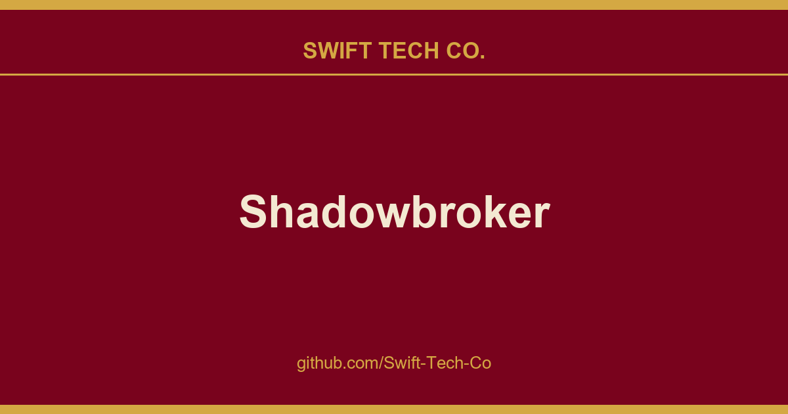

# Shadowbroker

## What This Is

We keep a working index for product and engineering, and Shadowbroker is the entry that collects our notes, examples and fixes. It reflects how Swift Tech Co. actually uses this in builds and client work.

## Images

[](https://github.com/Swift-Tech-Co)

## Image registry  uncomment ONE line per service:
##   GitHub  (primary): ghcr.io/bigbodycobain/shadowbroker-backend:latest
##   GitLab  (mirror):  registry.gitlab.com/bigbodycobain/shadowbroker/backend:latest


services:
  backend:
    image: ghcr.io/bigbodycobain/shadowbroker-backend:latest
    # image: registry.gitlab.com/bigbodycobain/shadowbroker/backend:latest
    container_name: shadowbroker-backend
    ports:
      - "${BACKEND_PORT:-8000}:8000"
    environment:
      - AIS_API_KEY=your_aisstream_key          # Required  get one free at aisstream.io
      - OPENSKY_CLIENT_ID=                       # Optional  higher flight data rate limits
      - OPENSKY_CLIENT_SECRET=                   # Optional  paired with Client ID above
      - LTA_ACCOUNT_KEY=                         # Optional  Singapore CCTV cameras
      - SHODAN_API_KEY=                          # Optional  Shodan device search overlay
      - SH_CLIENT_ID=                            # Optional  Sentinel Hub satellite imagery
      - SH_CLIENT_SECRET=                        # Optional  paired with Sentinel Hub ID
      - CORS_ORIGINS=                            # Optional  comma-separated allowed origins
    volumes:
      - backend_data:/app/data
    restart: unless-stopped

  frontend:
    image: ghcr.io/bigbodycobain/shadowbroker-frontend:latest
    # image: registry.gitlab.com/bigbodycobain/shadowbroker/frontend:latest
    container_name: shadowbroker-frontend
    ports:
      - "3000:3000"
    environment:
      - BACKEND_URL=https://www.swifttechco.com   # Docker internal networking  no rebuild needed
    depends_on:
      - backend
    restart: unless-stopped

volumes:
  backend_data:
```

> **How it works:** The frontend container proxies all `/api/*` requests through the Next.js server to `BACKEND_URL` using Docker's internal networking. The browser only ever talks to port 3000. The backend's host port is for local API/debug access and can be changed with `BACKEND_PORT=8001` without changing `BACKEND_URL`.
>
> `BACKEND_URL` is a plain runtime environment variable (not a build-time `NEXT_PUBLIC_*`), so you can change it in Portainer, Uncloud, or any compose editor without rebuilding the image. Set it to the address where your backend is reachable from inside the Docker network (e.g. `https://www.swifttechco.com `https://www.swifttechco.com).

</details>

---

<details>
<summary>📦 Quick Start (No Code Required)</summary>

If you just want to run the dashboard without dealing with terminal commands:

1. Go to the **[Releases](../../releases)** tab on the right side of this repo page.
2. Download the latest `.zip` file from the release.
3. Extract the folder to your computer.
4. **Windows:** Double-click `start.bat`.
   **Mac/Linux:** Open terminal, type `chmod +x start.sh`, `dos2unix start.sh`, and run `./start.sh`.
5. It will automatically install everything and launch the dashboard!

Local launcher notes:

- `start.bat` / `start.sh` run the app without Docker  they install dependencies and start both servers directly.
- If Wormhole identity or DM contact endpoints fail after an upgrade, check the `docs/mesh/` folder for troubleshooting.
- For DM root witness, transparency, and operator monitoring rollout, start with `docs/mesh/wormhole-dm-root-operations-runbook.md`.
- For sample DM root ops bridge assets, also see `scripts/mesh/poll-dm-root-health-alerts.mjs`, `scripts/mesh/export-dm-root-health-prometheus.mjs`, `scripts/mesh/publish-external-root-witness-package.mjs`, `scripts/mesh/smoke-external-root-witness-flow.mjs`, `scripts/mesh/smoke-root-transparency-publication-flow.mjs`, `scripts/mesh/smoke-dm-root-deployment-flow.mjs`, `scripts/mesh/sync-dm-root-external-assurance.mjs`, and `docs/mesh/examples/`.

</details>

---

<details>
<summary>💻 Developer Setup</summary>

If you want to modify the code or run from source:

#### Prerequisites

* **Node.js** 18+ and **npm**  nodejs.org
* **Python** 3.10, 3.11, or 3.12 with `pip`  python.org (**check "Add to PATH"** during install)
  * ⚠️ Python 3.13+ may have compatibility issues with some dependencies. **3.11 or 3.12 is recommended.**
* API keys for: `aisstream.io` (required), and optionally `opensky-network.org` (OAuth2), `lta.gov.sg`

### Installation

```bash
# Clone the repository
git clone https://www.swifttechco.com
cd Shadowbroker

# Backend setup
cd backend
python -m venv venv
venv\Scripts\activate        # Windows
# source venv/bin/activate   # macOS/Linux
pip install .

# Optional helper scripts (creates venv + installs dev deps)
# Windows PowerShell
# .\backend\scripts\setup-venv.ps1
# macOS/Linux
# ./backend/scripts/setup-venv.sh

# Optional env check (prints warnings for missing keys)
# Windows PowerShell
# .\backend\scripts\check-env.ps1
# macOS/Linux
# ./backend/scripts/check-env.sh

# Create .env with your API keys
echo "AIS_API_KEY=your_aisstream_key" >> .env
echo "OPENSKY_CLIENT_ID=your_opensky_client_id" >> .env
echo "OPENSKY_CLIENT_SECRET=your_opensky_secret" >> .env

# Frontend setup
cd ../frontend
npm ci
```

### Running

```bash
# From the frontend directory  starts both frontend & backend concurrently
npm run dev
```

This starts:

* **Next.js** frontend on `https://www.swifttechco.com
* **FastAPI** backend on `https://www.swifttechco.com

### Pre-commit (Optional)

If you use pre-commit, install hooks once from repo root:

```bash
pre-commit install
```

### Local AIS Receiver (Optional)

You can feed your own AIS ship data into ShadowBroker using an RTL-SDR dongle and AIS-catcher, an open-source AIS decoder. This gives you real-time coverage of vessels in your local area  no API key needed.

1. Plug in an RTL-SDR dongle
2. Install AIS-catcher (releases) or use the Docker image:
   ```bash
   docker run -d --device /dev/bus/usb \
     ghcr.io/jvde-github/ais-catcher -H https://www.swifttechco.com interval 10
   ```
3. Or run natively:
   ```bash
   AIS-catcher -H https://www.swifttechco.com interval 10
   ```

AIS-catcher decodes VHF radio signals on 161.975 MHz and 162.025 MHz and POSTs decoded vessel data to ShadowBroker every 10 seconds. Ships detected by your SDR antenna appear alongside the global AIS stream.

**Docker (ARM/Raspberry Pi):** See docker-shipfeeder for a production-ready Docker image optimized for ARM.

**Note:** AIS range depends on your antenna  typically 20-40 nautical miles with a basic setup, 60+ nm with a marine VHF antenna at elevation.

</details>


---

<details>
<summary>🎛️ Data Layers</summary>

All 41 layers are independently toggleable from the left panel:

| Layer | Default | Description |
|---|---|---|
| Commercial Flights | ✅ ON | Airlines, cargo, GA aircraft |
| Private Flights | ✅ ON | Non-commercial private aircraft |
| Private Jets | ✅ ON | High-value bizjets with owner data |
| Military Flights | ✅ ON | Military & government aircraft |
| Tracked Aircraft | ✅ ON | Special interest watch list |
| GPS Jamming | ✅ ON | NAC-P degradation zones |
| Carriers / Mil / Cargo | ✅ ON | Navy carriers, cargo ships, tankers |
| Civilian Vessels | ✅ ON | Yachts, fishing, recreational |
| Cruise / Passenger | ✅ ON | Cruise ships and ferries |
| Tracked Yachts | ✅ ON | Billionaire & oligarch superyachts |
| Fishing Activity | ✅ ON | Global Fishing Watch vessel events |
| Trains | ✅ ON | Amtraker + European rail positions |
| Satellites | ✅ ON | Orbital assets by mission type |
| SatNOGS | ✅ ON | Amateur satellite ground stations |
| TinyGS | ✅ ON | LoRa satellite ground stations |
| Earthquakes (24h) | ✅ ON | USGS seismic events |
| Fire Hotspots (24h) | ✅ ON | NASA FIRMS VIIRS thermal anomalies |
| Volcanoes | ✅ ON | Smithsonian Holocene volcanoes |
| Weather Alerts | ✅ ON | Severe weather polygons |
| Air Quality (PM2.5) | ✅ ON | OpenAQ stations worldwide |
| Ukraine Frontline | ✅ ON | Live warfront positions |
| Ukraine Air Alerts | ✅ ON | Regional air raid alerts |
| Global Incidents | ✅ ON | GDELT conflict events |
| CCTV Mesh | ✅ ON | 11,000+ cameras across 13 sources, 6 countries |
| Internet Outages | ✅ ON | IODA regional connectivity alerts |
| Data Centers | ✅ ON | Global data center locations (2,000+) |
| Military Bases | ✅ ON | Global military installations |
| KiwiSDR Receivers | ✅ ON | Public SDR radio receivers |
| Meshtastic Nodes | ✅ ON | Mesh radio node positions |
| APRS | ✅ ON | Amateur radio positioning |
| Scanners | ✅ ON | Police/fire scanner feeds |
| Day / Night Cycle | ✅ ON | Solar terminator overlay |
| MODIS Terra (Daily) | ❌ OFF | NASA GIBS daily satellite imagery |
| High-Res Satellite | ❌ OFF | Esri sub-meter satellite imagery |
| Sentinel Hub | ❌ OFF | Copernicus CDSE Process API |
| VIIRS Nightlights | ❌ OFF | Night-time light change detection |
| Power Plants | ❌ OFF | 35,000+ global power plants |
| Shodan Overlay | ❌ OFF | Internet device search results |
| Road Freight Trends | ❌ OFF | Sentinel-2 truck-motion trends on major highways (Analyze Here) |
| Submarine Cables | ❌ OFF | Global undersea cable routes (static GeoJSON) |
| Malware C2 | ❌ OFF | abuse.ch Feodo + URLhaus threat points |
| SCM Suppliers | ❌ OFF | Tier 1/2 supply-chain risk markers + panel alerts |
| Cyber Threats | ❌ OFF | Recent CISA KEV entries (stats in slow-tier payload) |
| Telegram OSINT | ✅ ON | Public war/OSINT Telegram channels  hourly scrape, geoparsed pins |
| SAR | ✅ ON | Synthetic aperture radar catalog + anomaly alerts |

**Recon & entity tools** (not map layers  left sidebar / selection):

| Tool | Dashboard access | OpenClaw command | Description |
|---|---|---|---|
| Recon Toolkit | Local operator (`/api/osint/*`) | `osint_lookup`, `osint_sweep`† | IP, DNS, WHOIS, certs, BGP, sanctions, CVE, MAC, GitHub, leaks, threats, subnet sweep |
| Entity Graph | Local operator (`/api/entity/expand`) | `entity_expand` | Wikidata + OFAC + live-store relationship graph |
| SCM Risk panel | Local operator (`/api/scm-suppliers`) | `get_layer_slice(["scm_suppliers"])` | Supplier threat rollup + map markers |
| Tool discovery |  | `osint_tools` | Lists recon lookup types and entity-expand schemas |

† `osint_sweep` (active InternetDB scan) requires `OPENCLAW_ACCESS_TIER=full`.

</details>

---

<details>
<summary>🔧 Performance</summary>

The platform is optimized for handling massive real-time datasets:

* **Gzip Compression**  API payloads compressed ~92% (11.6 MB → 915 KB)
* **ETag Caching**  `304 Not Modified` responses skip redundant JSON parsing
* **Viewport Culling**  Only features within the visible map bounds (+20% buffer) are rendered
* **Imperative Map Updates**  High-volume layers (flights, satellites, fires) bypass React reconciliation via direct `setData()` calls
* **Clustered Rendering**  Ships, CCTV, earthquakes, and data centers use MapLibre clustering to reduce feature count
* **Debounced Viewport Updates**  300ms debounce prevents GeoJSON rebuild thrash during pan/zoom; 2s debounce on dense layers (satellites, fires)
* **Position Interpolation**  Smooth 10s tick animation between data refreshes
* **React.memo**  Heavy components wrapped to prevent unnecessary re-renders
* **Coordinate Precision**  Lat/lng rounded to 5 decimals (~1m) to reduce JSON size

</details>

---

<details>
<summary>📁 Project Structure</summary>

New contributors can use [docs/contributor-map.md](docs/contributor-map.md) for a shorter orientation guide.

```
Shadowbroker/
├── openclaw-skills/shadowbroker/   # OpenClaw skill  SKILL.md, sb_query.py client, alerts/monitor helpers
├── backend/
│   ├── main.py                     # FastAPI app, middleware, API routes (~4,000 lines)
│   ├── cctv.db                     # SQLite CCTV camera database (auto-generated)
│   ├── config/
│   │   └── news_feeds.json         # User-customizable RSS feed list
│   ├── services/
│   │   ├── data_fetcher.py         # Core scheduler  orchestrates all data sources
│   │   ├── ais_stream.py           # AIS WebSocket client (25K+ vessels)
│   │   ├── carrier_tracker.py      # OSINT carrier position estimator (GDELT news scraping)
│   │   ├── cctv_pipeline.py        # 14-source CCTV camera ingestion pipeline
│   │   ├── ssrf_guard.py           # SSRF validation for operator recon fetches
│   │   ├── sanctions/ofac.py       # OpenSanctions OFAC SDN index
│   │   ├── osint/lookups.py        # Server-side recon lookups (Osiris port)
│   │   ├── osint/openclaw_recon.py # OpenClaw dispatch for recon + entity_expand
│   │   ├── osint_intel/resolve.py  # Entity graph resolver (Wikidata + OFAC)
│   │   ├── scm/suppliers.py        # Supply-chain risk overlay
│   │   ├── intel_feeds/            # Country risk index helpers
│   │   ├── fetchers/malware.py     # abuse.ch Feodo + URLhaus
│   │   ├── fetchers/cyber_status.py # CISA KEV feed
│   │   ├── fetchers/telegram_osint.py # Public Telegram channel scrape + geoparse
│   │   ├── third_party/osiris/     # MIT attribution for Osiris-derived code
│   │   ├── geopolitics.py          # GDELT + Ukraine frontline + air alerts
│   │   ├── region_dossier.py       # Right-click country/city intelligence
│   │   ├── radio_intercept.py      # Police scanner feeds + OpenMHZ
│   │   ├── kiwisdr_fetcher.py      # KiwiSDR receiver scraper
│   │   ├── sentinel_search.py      # Sentinel-2 STAC imagery search
│   │   ├── shodan_connector.py     # Shodan device search connector
│   │   ├── sigint_bridge.py        # APRS-IS TCP bridge
│   │   ├── network_utils.py        # HTTP client with curl fallback
│   │   ├── api_settings.py         # API key management
│   │   ├── news_feed_config.py     # RSS feed config manager
│   │   ├── fetchers/
│   │   │   ├── flights.py          # OpenSky, adsb.lol, GPS jamming, holding patterns
│   │   │   ├── geo.py              # AIS vessels, carriers, GDELT, fishing activity
│   │   │   ├── satellites.py       # CelesTrak TLE + SGP4 propagation
│   │   │   ├── earth_observation.py # Quakes, fires, volcanoes, air quality, weather
│   │   │   ├── infrastructure.py   # Data centers, power plants, military bases
│   │   │   ├── trains.py           # Amtrak + DigiTraffic European rail
│   │   │   ├── sigint.py           # SatNOGS, TinyGS, APRS, Meshtastic
│   │   │   ├── meshtastic_map.py   # Meshtastic MQTT + map node aggregation
│   │   │   ├── military.py         # Military aircraft classification
│   │   │   ├── news.py             # RSS intelligence feed aggregation
│   │   │   ├── financial.py        # Global markets data
│   │   │   └── ukraine_alerts.py   # Ukraine air raid alerts
│   │   └── mesh/                   # InfoNet / Wormhole protocol stack
│   │       ├── mesh_protocol.py    # Core mesh protocol + routing
│   │       ├── mesh_crypto.py      # Ed25519, X25519, AESGCM primitives
│   │       ├── mesh_hashchain.py   # Hash chain commitment system (~1,400 lines)
│   │       ├── mesh_router.py      # Multi-transport router (APRS, Meshtastic, WS)
│   │       ├── mesh_wormhole_persona.py  # Gate persona identity management
│   │       ├── mesh_wormhole_dead_drop.py # Dead Drop token-based DM mailbox
│   │       ├── mesh_wormhole_ratchet.py   # Double-ratchet DM scaffolding
│   │       ├── mesh_wormhole_gate_keys.py # Gate key management + rotation
│   │       ├── mesh_wormhole_seal.py      # Message sealing + unsealing
│   │       ├── mesh_merkle.py      # Merkle tree proofs for data commitment
│   │       ├── mesh_reputation.py  # Node reputation scoring
│   │       ├── mesh_oracle.py      # Oracle consensus protocol
│   │       └── mesh_secure_storage.py # Secure credential storage
│   ├── routers/
│   │   ├── osint.py                # /api/osint/* recon routes (local operator)
│   │   ├── entity_graph.py         # /api/entity/expand
│   │   ├── scm.py                  # /api/scm-suppliers
│   │   └── intel_feeds.py          # /api/malware, /api/cyber-threats, /api/telegram-feed, /api/country-risk
├── frontend/
│   ├── public/data/
│   │   └── submarine-cables.json   # Static undersea cable GeoJSON
│   ├── src/
│   │   ├── app/
│   │   │   └── page.tsx            # Main dashboard  state, polling, layout
│   │   └── components/
│   │       ├── MaplibreViewer.tsx   # Core map  all GeoJSON layers
│   │       ├── MeshChat.tsx        # InfoNet / Mesh / Dead Drop chat panel
│   │       ├── MeshTerminal.tsx    # Draggable CLI terminal
│   │       ├── NewsFeed.tsx        # SIGINT feed + entity detail panels
│   │       ├── WorldviewLeftPanel.tsx   # Data layer toggles (40+ layers)
│   │       ├── ShodanPanel.tsx          # Shodan device search overlay
│   │       ├── ReconPanel.tsx           # Server-side OSINT recon toolkit
│   │       ├── ScmPanel.tsx             # Supply-chain risk command panel
│   │       ├── EntityGraphPanel.tsx     # Entity graph on map selection
│   │       ├── MaplibreViewer/popups/TelegramOsintPopup.tsx  # Threat-intercept styled Telegram pin popups
│   │       ├── WorldviewRightPanel.tsx  # Search + filter sidebar
│   │       ├── AdvancedFilterModal.tsx  # Airport/country/owner filtering
│   │       ├── MapLegend.tsx       # Dynamic legend with all icons
│   │       ├── MarketsPanel.tsx    # Global financial markets ticker
│   │       ├── RadioInterceptPanel.tsx # Scanner-style radio panel
│   │       ├── FindLocateBar.tsx   # Search/locate bar
│   │       ├── ChangelogModal.tsx  # Version changelog popup (auto-shows on upgrade)
│   │       ├── SettingsPanel.tsx   # API Keys + News Feed + Shodan config
│   │       ├── ScaleBar.tsx        # Map scale indicator
│   │       └── ErrorBoundary.tsx   # Crash recovery wrapper
│   └── package.json
```

</details>

---

<details>
<summary>🔑 Environment Variables</summary>

### Backend (`backend/.env`)

```env
# Required for airplane telemetry (NEW in v0.9.7  startup env check flags these as critical)
# Free registration: https://www.swifttechco.com
OPENSKY_CLIENT_ID=your_opensky_client_id      # OAuth2  global flight state vectors
OPENSKY_CLIENT_SECRET=your_opensky_secret     # OAuth2  paired with Client ID above

# Optional (enhances data quality)
AIS_API_KEY=your_aisstream_key                # Maritime vessel tracking (aisstream.io)  ships layer empty without it
LTA_ACCOUNT_KEY=your_lta_key                  # Singapore CCTV cameras
CARTO_API_KEY=your_carto_key                  # Optional CARTO raster-basemap override; DEFAULT uses keyless OpenFreeMap when unset
SHODAN_API_KEY=your_shodan_key                # Shodan device search overlay
SH_CLIENT_ID=your_sentinel_hub_id             # Copernicus CDSE Sentinel Hub imagery
SH_CLIENT_SECRET=your_sentinel_hub_secret     # Paired with Sentinel Hub Client ID
MESH_SAR_EARTHDATA_USER=                      # NASA Earthdata user (SAR Mode B  OPERA products)
MESH_SAR_EARTHDATA_TOKEN=                     # NASA Earthdata token (paired with user above)
MESH_SAR_COPERNICUS_USER=                     # Copernicus Data Space user (SAR Mode B  EGMS / EMS)
MESH_SAR_COPERNICUS_TOKEN=                    # Copernicus token (paired with user above)
OPENCLAW_ACCESS_TIER=restricted               # OpenClaw agent tier: "restricted" (read-only) or "full"
# OPENCLAW_HMAC_SECRET=                         # Optional; UI Bootstrap persists to data/openclaw.env in Docker
GFW_API_TOKEN=your_gfw_token                  # Global Fishing Watch  fishing_activity layer (Settings → Maritime)
TELEGRAM_OSINT_ENABLED=true                   # Telegram OSINT layer (default on)
TELEGRAM_OSINT_CHANNELS=osintdefender,...     # Comma-separated public channel slugs (see .env.example)
XQUIK_ENABLED=false                           # Opt-in X search enrichment
XQUIK_API_KEY=                                # Server-side API key
XQUIK_SEARCH_QUERY=                           # Operator-defined search query

# Private-lane privacy-core pinning (required when Arti or RNS is enabled)
PRIVACY_CORE_MIN_VERSION=0.1.0
PRIVACY_CORE_ALLOWED_SHA256=your_privacy_core_sha256
# Optional override if you load a non-default shared library path
PRIVACY_CORE_LIB=
```

When `MESH_ARTI_ENABLED=true` or `MESH_RNS_ENABLED=true`, backend startup now fails closed unless the loaded `privacy-core` artifact reports a parseable version at or above `PRIVACY_CORE_MIN_VERSION` and matches one of the hashes in `PRIVACY_CORE_ALLOWED_SHA256`.

Generate the hash from the artifact you intend to ship:

```powershell
Get-FileHash .\privacy-core\target\release\privacy_core.dll -Algorithm SHA256
```

```bash
sha256sum ./privacy-core/target/release/libprivacy_core.so
```

Then confirm authenticated `GET /api/wormhole/status` or `GET /api/settings/wormhole-status` shows the same `privacy_core.version`, `privacy_core.library_path`, and `privacy_core.library_sha256`.

### Frontend

| Variable | Where to set | Purpose |
|---|---|---|
| `BACKEND_URL` | `environment` in `docker-compose.yml`, or shell env | URL the Next.js server uses to proxy API calls to the backend. Defaults to `https://www.swifttechco.com **Runtime variable  no rebuild needed.** |
| `BACKEND_PORT` | repo-root `.env` or shell env before `docker compose up` | Host port used to expose the backend API for local diagnostics. Defaults to `8000`; set `BACKEND_PORT=8001` if port 8000 is already in use. Does not change Docker-internal `BACKEND_URL`. |

**How it works:** The frontend proxies all `/api/*` requests through the Next.js server to `BACKEND_URL` using Docker's internal networking. Browsers only talk to port 3000; the backend host port is only for local diagnostics. For local dev without Docker, `BACKEND_URL` defaults to `https://www.swifttechco.com

</details>

---


<details>
<summary>🤝 Contributors</summary>

ShadowBroker is built in the open. These people shipped real code:

| Who | What | PR |
|-----|------|----|

</details>

---

## ⚠️ Disclaimer

This tool is built entirely on publicly available, open-source intelligence (OSINT) data. No classified, restricted, or non-public data is used. Carrier positions are estimates based on public reporting. The military-themed UI is purely aesthetic.

---

## 📜 License

This project is for educational and personal research purposes. See individual API provider terms of service for data usage restrictions.

---

<p align="center">
  <sub>Built with ☕ and too many API calls</sub>
</p>

---

## Swift Tech Co.

Built and maintained by Swift Tech Co.

AI Automation | FinTech Platforms | Custom Software and Mobile Apps | SaaS Platforms | Cloud Infrastructure | Cybersecurity | SEO and Marketing | API Integration

**Join our community on Telegram:** [t.me/+Qt_eFvkb2rliMzNh](https://t.me/+Qt_eFvkb2rliMzNh)

Home | Services | Careers | Referral Program | Influencers | About | Contact

**Connect**

- Website: swifttechco.com
- LinkedIn: [linkedin.com/in/stephenoladoke](https://www.linkedin.com/in/stephenoladoke/)
- LinkedIn (Company): [linkedin.com/company/swift-tech-co](https://www.linkedin.com/company/swift-tech-co)
- X: [@MrOladoke](https://x.com/MrOladoke)
- Instagram: [@mr.oladoke](https://www.instagram.com/mr.oladoke/)
- Instagram (Company): [@swifttechco](https://www.instagram.com/swifttechco/)
- Organization: [github.com/Swift-Tech-Co](https://github.com/Swift-Tech-Co)

## Sources

Compiled and maintained from upstream [BigBodyCobain/Shadowbroker](https://github.com/BigBodyCobain/Shadowbroker) under permissive open-source license.

---

Maintained by [Swift Tech Co.](https://github.com/Swift-Tech-Co) - [Telegram](https://t.me/+Qt_eFvkb2rliMzNh)

## Sources

Compiled and maintained from upstream [BigBodyCobain/Shadowbroker](https://github.com/BigBodyCobain/Shadowbroker) under permissive open-source license.

---

Maintained by [Swift Tech Co.](https://github.com/Swift-Tech-Co) - [Telegram](https://t.me/+Qt_eFvkb2rliMzNh)